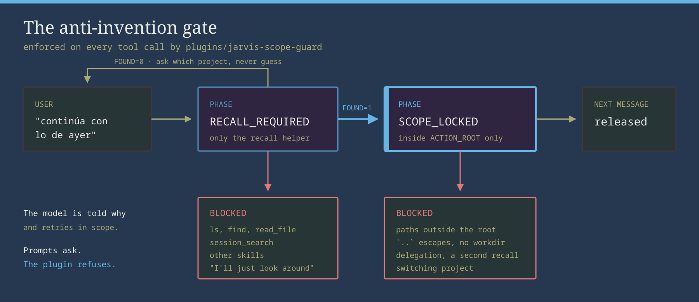

<div align="center">

<picture>
  <source media="(prefers-color-scheme: dark)" srcset="assets/logo-dark.png">
  
</picture>

<p>
<em>A local model in an agent framework rarely fails because it is dumb.<br>
It fails because it guesses which project you meant, wanders into the repo next door,<br>
and tells you the tests passed when nothing ran.</em><br>
<strong>This is the harness that stops that for <a href="https://github.com/NousResearch/hermes-agent">Hermes Agent</a> on a single 16 GB GPU:<br>config that was measured, a recall helper that abstains instead of guessing, and a plugin that refuses the drifting tool call.</strong>
</p>

<p>
  
  
  
  
  
</p>

<a href="#-quick-path"><strong>Quick path</strong></a> ·
<a href="#-the-gate-in-action"><strong>The gate in action</strong></a> ·
<a href="#-recall-that-abstains"><strong>Recall</strong></a> ·
<a href="#-what-is-in-here"><strong>What is in here</strong></a> ·
<a href="#-how-the-gate-works"><strong>How it works</strong></a> ·
<a href="#-known-limitations"><strong>Limitations</strong></a> ·
<a href="#-tests-and-evaluation"><strong>Tests</strong></a>

</div>

---

<a href="#-how-the-gate-works"></a>

<div align="center">

**models** `qwen3-coder` (30B-A3B) · `gpt-oss:20b` · **runtime** Ollama, 64k context, q8_0 KV cache<br>
**plugin** `jarvis-scope-guard` v9.0 · **recall** `jarvis-episode-recall.py` → `JARVIS_HANDOFF_V2` · **deps** stdlib only

<br>

<sub>Two kinds of image on this page. The logo and the diagram are <b>rendered</b> by
<code>scripts/render-assets.sh</code> from the palette in <code>assets/theme.conf</code> (the emblem was generated once
with a local Flux model and is kept under <code>assets/brand/</code>). The terminal GIFs are <b>real output</b>:
<code>asciinema</code> recordings of the actual plugin hooks and recall helper, run against a fictional home that
<code>demo/world.py</code> builds from scratch. No real history, no mock-ups.</sub>

</div>

---

## ⚡ Quick path

```bash
git clone https://github.com/gitsual/hermes-local-harness && cd hermes-local-harness
./install.sh                  # plugin + recall skill into ~/.hermes, with backups
# then follow the 5 manual steps it prints (config merge, Ollama drop-in, restart)
```

Verify:

```bash
ollama ps            # CONTEXT column must say 65536, PROCESSOR ideally 100% GPU
hermes prompt-size   # overhead should be well under 50% of the window
```

Out of the box, a local model in Hermes fails in ways that look like "the model is dumb" but are almost always
configuration. Every fix here was isolated with an A/B test before it was kept, and every config value carries a
comment with the reason. The measurements behind them are in [`docs/findings.md`](docs/findings.md).

---

## 🛡️ The gate in action

The user says *"continúa con el webhook de stripe"*. The model would love to `ls ~/work` and pick something. It
cannot. These are the real `pre_tool_call` verdicts the plugin returns, in order:


1. `ls ~/work` and `session_search` are **blocked**: recall comes first.
2. The recall helper runs and returns a handoff for `~/work/billing-api`. Scope is now **locked** there.
3. Reading the sibling repo's README and a `cat ../trailapp` escape are **blocked**, with the reason handed back to
   the model so it retries in scope.
4. Reading `retry.py` and running `pytest` inside the root go through.

Prompts only *ask* the model to behave. The plugin *refuses* the tool call. In real use over ~430 turns the gate
fired 33 times, locked scope 28 times and blocked 38 drifting calls.

---

## 🧭 Recall that abstains

`jarvis-episode-recall.py` turns a vague request into a machine-readable handoff, or refuses to:


It locks a project only from evidence, strongest first:

| Mode | Evidence |
|------|----------|
| `pin` | an explicit pin you configured for a topic |
| `anchor` | a path written in the request |
| `statusline` | the directory shown in a pasted Claude Code status line |
| `name` | a project named in the request |
| `current` | work already done in this session, followed across context compression |
| `content` | rare, name-shaped words whose past turns worked in one clear place |
| `abstain` | anything else: `FOUND=0`, ask the user which project |

Rarity only counts as evidence when the history is big enough for a word to be rare (150+ sessions). On a small
corpus it abstains rather than guess from noise.

---

## 📦 What is in here

| Layer | File | Problem it fixes |
|-------|------|------------------|
| Hermes config | `config/hermes.fragment.yaml` | Tool calls emitted as text, empty replies, compression aborts, broken web search, context eaten by tool schemas |
| Ollama | `config/ollama/20-local-agent.conf` | 64k context spilling to CPU on 16 GB |
| Plugin | `plugins/jarvis-scope-guard/` | Model "continuing" work by guessing the project, then wandering into sibling repos |
| Skill | `skills/jarvis/jarvis-recall/` | Deterministic recall: finds the previous episode and emits a machine-readable handoff |
| Persona | `soul/SOUL.example.md` | Definition of done: "a command ran" is not "the task is finished" |
| Patches | `patches/` | Hermes source fixes that config cannot reach |
| Eval | `tools/eval-recall.py` | Scores recall end to end against your own labeled history |
| Demo | `demo/`, `scripts/render-assets.sh` | The fictional world and the recordings on this page |

---

## ⚙️ How the gate works

The plugin hooks into Hermes (`pre_llm_call`, `pre_tool_call`, `post_tool_call`) and turns "continue what we did"
into a two-phase state machine, enforced mechanically on every tool call:

- **`RECALL_REQUIRED`**: a continuation phrase was detected. Every tool except the recall skill and helper is
  blocked.
- **`SCOPE_LOCKED`**: the helper printed `JARVIS_HANDOFF_V2 FOUND=1 ACTION_ROOT=…`. Paths outside the root, `..`
  escapes, commands without a workdir, `session_search`, delegation, a second recall and other skills are blocked.
- **Released** on the next user message.

`FOUND=0` never unlocks anything: the model has to ask. Continuation phrases are detected in Spanish and English
(`CONTINUATION_PATTERNS` in the plugin).

---

## 🚧 Known limitations

- **Recall abstains rather than guesses.** Against every continuation request in a real `state.db` (51 labeled
  cases) it makes no wrong lock, but all 51 were also used to tune it: there is no untouched test set left. For a
  topic it gets wrong, add a pin (`examples/jarvis-episode-pins.example.json` → `~/.hermes/jarvis-episode-pins.json`).
- **A path with spaces typed without quotes is cut at the first space** and resolves to a directory that does not
  exist; live recall then abstains.
- **qwen3-coder at 64k does not fit fully in 16 GB.** Expect part of it on CPU (`ollama ps`). `gpt-oss:20b` fits
  at 64k with the q8_0 KV cache at 100% GPU.
- **Patches are tied to Hermes 0.21.0.** Re-check them after every update.
- **Installer and Ollama drop-in are Linux only** (bash + systemd). The plugin and the recall helper are plain
  Python and the whole test suite passes on Linux and Windows 11. On Windows, recall reads paths from tool
  arguments but only finds POSIX-style paths in free text.

---

## ✅ Tests and evaluation

```bash
python3 -m pytest -q tests
```

The tests drive the plugin hooks directly, exactly as Hermes calls them. No model or running Hermes is needed.

To score recall end to end against your own history, label past requests (format in the docstring of
`tools/eval-recall.py`) and run:

```bash
python3 tools/eval-recall.py ~/.hermes/jarvis-recall-eval.json -v
```

To regenerate every image on this page (needs `magick`, `rsvg-convert`, `asciinema`, `agg`):

```bash
scripts/render-assets.sh            # logos, diagram and both GIFs
```

---

<div align="center">
<sub>MIT · the human leads, the model executes, the plugin keeps it honest</sub>
</div>
